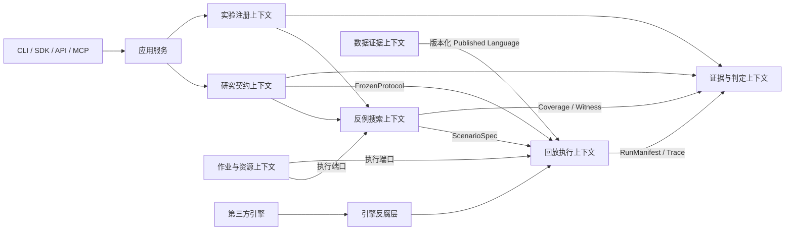
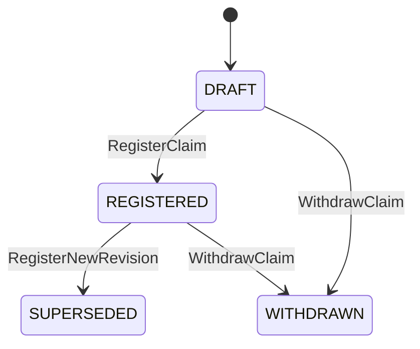

# TickWitness：领域模型与边界

状态：**Proposed / 尚未实现**。TickWitness 是本文所称的研究证据平台，目标仓库为 `Darrenus/tickwitness`。本文定义目标领域模型、术语与必须保持的语义，不代表现有代码已具备这些能力。

实施阶段及当前 gate 以 [路线图](../planning/roadmap.md) 与 [Sprint backlog](../planning/sprint-backlog.md) 为准；本文定义跨阶段保持的领域约束，不把目标架构的全部能力视为首版前置条件。项目软件许可已选择 Apache-2.0，第三方引擎和数据仍分别核查其许可。

## 1. 平台负责回答的问题

用户提交的研究对象不是一条交易指令，而是一条可检验的研究声明，例如：“在指定数据、持仓限制、费用和成交假设下，策略 A 的样本外净收益高于基线 B。”平台冻结声明与评价规则，验证数据和执行假设，在明确范围内寻找反例，最后输出可以重放、可以质疑的证据。

核心产品结果是 **研究声明 + 冻结协议 + 执行记录 + 可重放反例或搜索覆盖 + 条件性判定**。收益曲线、Sharpe、Agent 对话都是这一结果的附属表达。

本文的 DDD 指领域边界、通用语言和不变量，不要求微服务，也不要求 Event Sourcing。初期采用模块化单体；数据库中的当前状态、不可变版本和事务 outbox 足以支持审计。领域事件是事实通知，不等于整个系统必须从事件日志恢复。

## 2. 通用语言

| 术语 | 精确定义 | 不应混同的概念 |
| --- | --- | --- |
| 研究声明 `ResearchClaim` | 包含对象、指标、比较基线、适用范围和可证伪条件的版本化命题 | 自然语言愿望、策略代码、盈利承诺 |
| 研究协议 `ValidationProtocol` | 执行前冻结的指标公式、窗口、假设集合、拒绝规则、预算和评价规则 | 看过结果后修改的分析配置 |
| 假设 `Assumption` | 无法由输入数据直接确定、但会影响结果的建模选择 | 已观测事实 |
| 观测相容情景 `ObservationCompatibleScenario` | 在已记录观测、顺序约束、时钟证据和明示模型约束内，对未知部分的一种解释 | 新增断网或新增延迟的压力测试 |
| 反事实压力情景 `CounterfactualStressScenario` | 人为施加额外延迟、缺失、费用或故障，检验指定条件变化后的行为 | 对真实历史的重建 |
| 可行性 `Feasibility` | 某情景是否满足其类型对应的全部约束，且能被参考验证器检查 | “看起来合理”、搜索器自行打分 |
| 反例 `Counterexample` | 一次可行、成功执行、可重复验证且使预先定义的命题失败的情景与轨迹 | 崩溃、超时、未完成运行 |
| 见证 `Witness` | 能复现一个反例的输入引用、初始状态、变换、种子、执行环境和关键轨迹 | 仅一张截图或一段 Agent 解释 |
| 最简见证 `MinimizedWitness` | 在明确的缩减操作和验证预算内，无法继续缩减的见证 | 全局最小、最可能发生的故障 |
| 证据包 `EvidenceBundle` | 按内容寻址、不可变、可核验的协议、数据、运行、轨迹和报告集合 | 未落盘的 UI 状态 |
| 判定 `Verdict` | 确定性评价器根据冻结规则和证据生成的范围限定结论 | LLM 意见、未来收益保证 |
| 搜索覆盖 `SearchCoverage` | 实际验证过的情景、失败/未完成情景及未探索范围 | 搜索空间的抽样通过率等于真实成功概率 |
| 捕获水位 `CaptureWatermark` | 某次数据版本允许读取的已提交捕获记录边界 | 交易所所有事件已完整到达的证明 |

“时点正确”必须说清采用哪个可知时间、哪个数据版本及哪段时钟证据。交易所事件时间不等于研究进程收到信息的时间；从历史文件导入时产生的导入时间也不能伪装成历史接收时间。

## 3. 战略设计

| 子域 | 分类 | 平台承担的独特责任 |
| --- | --- | --- |
| 研究声明与约束 | 核心域 | 把研究问题变成可证伪契约；冻结规则和权限边界 |
| 反例搜索 | 核心域 | 在分类明确的约束空间中找反例、记录搜索覆盖并缩减见证 |
| 证据与判定 | 核心域 | 证据可验证、结论可追溯、范围不被夸大 |
| 数据证据 | 支撑域 | 原始字节、序列、接收时间与数据修订的证据链 |
| 回放执行 | 支撑域 | 按给定语义执行策略和成交模型，产生可核验轨迹 |
| 实验注册 | 支撑域 | 登记全部尝试、冻结配置、区分探索与确认、控制封存样本访问 |
| 作业调度、身份、配额与运维 | 通用域 | 可靠执行、权限、资源隔离和故障恢复 |

不把采集器数量、两套自研回测引擎或聊天入口当核心域。引擎可替换，声明、证据与判定契约应长期稳定。

## 4. 限界上下文与 Context Map



箭头表示数据或契约流，不表示跨域直接修改聚合。跨上下文由应用服务协调，使用标识、不可变 DTO 和显式端口；不共享 ORM 实体。

- 研究契约是冻结协议的上游。回放和判定服从协议格式，但不能自行改写协议。
- 数据证据发布 `DatasetManifest` 和 `AvailabilityEvidence`。回放通过适配器消费，不依赖 DuckDB 表结构。
- 回放发布 `RunManifest`、规范化订单/成交轨迹及精确计算结果；反例搜索不读取引擎私有对象。
- 证据与判定只接受通过 schema、哈希和完整性检查的输入，不能调用搜索器替自己挑结果。
- 作业上下文管理租约和资源，不解释“策略有效”或“研究通过”。
- 交易所协议、第三方引擎、统计库、MCP 都放在反腐层之外。上游升级必须通过兼容性验证后进入领域语义。

## 5. 研究契约上下文

### 聚合与不变量

| 聚合根 | 实体 / 值对象 | 关键不变量 |
| --- | --- | --- |
| `ResearchClaim` | `ClaimRevision`、`MetricDefinition`、`Comparator`、`Scope`、`FalsificationPredicate` | 每个已注册版本有明确基线、评价范围和证伪条件；正文变化生成新版本；版本不能静默覆盖 |
| `ValidationProtocol` | `DatasetRef`、`StrategyArtifactRef`、`AssumptionSet`、`RubricVersion`、`Budget`、`SeedPolicy` | 冻结后内容与 digest 不变；所有外部输入精确指向版本和哈希；确认性运行不能引用仍可修改的配置 |
| `AssumptionSet` | `ClockConstraint`、`QueueConstraint`、`LatencyConstraint`、`GapPolicy`、`ImpactApplicability` | 观测事实与建模假设分开；不确定项注明证据来源、单位、范围和适用条件 |

`FrozenProtocol` 是冻结后的不可变快照，携带其上游版本和内容哈希，不是另一个可以修改同一协议的聚合。涉及多资产、资金费、借贷和交易所规则时，其版本也必须进入协议；尚不支持的规则应拒绝运行，不能默认忽略。

时钟范围、延迟范围等约束必须注明是物理/协议硬边界、实测校准区间还是研究者设置的范围。统计区间具有覆盖假设，不能直接升级为真实时间的绝对边界；“观测相容”始终相对于列明的证据与约束成立。

### 状态与交互



`ValidationProtocol` 的状态为 `DRAFT → VALIDATED → FROZEN`；校验失败保持草稿并记录原因。冻结协议的修正必须产生新版本，不允许回到草稿。

| 命令 | 领域事件 |
| --- | --- |
| `RegisterClaim` | `ClaimRegistered` |
| `ReviseClaim` | `ClaimRevisionCreated` |
| `ValidateProtocol` | `ProtocolValidated` / `ProtocolValidationFailed` |
| `FreezeProtocol` | `ProtocolFrozen` |
| `SupersedeProtocol` | `ProtocolSuperseded` |
| `WithdrawClaim` | `ClaimWithdrawn` |

冻结前的“预检”可以校验 schema、可用数据和运行规模；若预检读取评价结果，必须登记为研究尝试，不能当作没有发生。

## 6. 反例搜索上下文

| 聚合根 | 实体 / 值对象 | 关键不变量 |
| --- | --- | --- |
| `SearchCampaign` | `SearchObjective`、`SearchSpaceRef`、`BudgetLedger`、`Coverage` | 只能引用冻结协议；预算增量有独立记录；取消、失败、超时不能算通过 |
| `ScenarioSet` | `ScenarioSpec`、`ScenarioKind`、`ConstraintVersion` | 情景集合冻结后不可修改；新增情景形成新版本；每个情景明确属于观测相容或反事实压力 |
| `Witness` | `InitialStateRef`、`TransformSpec`、`TraceRef`、`ReplayReceipt`、`MinimalityClaim` | 必须先可行、再重放验证；缩减后的见证仍满足原情景约束与证伪条件 |

`ScenarioSpec` 不允许执行任意脚本来偷偷变换数据。初期由注册的 typed transformation 构成，每个变换说明允许修改的字段、前置条件、可行性规则和确定性版本。扩展自定义变换属于代码执行边界，需要相同的隔离和验证要求。

### 两类情景必须分开报告

| 类别 | 示例 | 可支持的陈述 |
| --- | --- | --- |
| `OBSERVATION_COMPATIBLE` | L2 撤单发生在己方订单前还是后；有证据支持的时钟误差区间内的跨源排序 | “在给定观测与约束下，存在另一种可行解释使结论不同” |
| `COUNTERFACTUAL_STRESS` | 额外增加 20 ms 延迟；人为丢弃一段接收消息；提高费用 | “在声明的额外压力条件下，该研究结论或系统行为失败” |

人为新加的延迟不能称为对既有历史的解释。两类情景的覆盖率、反例率和收益范围分开计算。只有两种均为观测相容、均完成独立验证、并导致相反的声明真假结果的见证，才支持 `NOT_IDENTIFIABLE_WITHIN_MODEL`；压力测试一正一负不支持这一结论。

### 状态与命令

搜索活动状态：`CREATED → VALIDATED → QUEUED → RUNNING → COMPLETED`。从运行中可进入 `CANCEL_REQUESTED → CANCELLED`；故障进入 `FAILED`；预算结束但有未完成范围进入 `PARTIAL`。`COMPLETED` 只表示预定作业已终结，不直接表示声明成立。

见证状态：`DISCOVERED → FEASIBLE → REPLAY_VERIFIED → MINIMIZING → SEALED`。任一步失败进入 `REJECTED`，保留失败原因；直接封存未经缩减的可重放见证是合法路径，必须标注 `NOT_MINIMIZED`。

| 命令 | 领域事件 |
| --- | --- |
| `CreateCampaign` | `CampaignCreated` |
| `SubmitScenario` | `ScenarioSubmitted` |
| `ValidateScenario` | `ScenarioAccepted` / `ScenarioRejected` |
| `RecordAttempt` | `AttemptRecorded` |
| `VerifyWitness` | `WitnessReplayVerified` / `WitnessVerificationFailed` |
| `MinimizeWitness` | `WitnessMinimized` / `MinimizationBudgetExhausted` |
| `CancelCampaign` | `CampaignCancellationRequested` |
| `FinalizeCoverage` | `CoverageFinalized` |

可行性由独立验证端口检查；不能把优化器的“找到了”当作通过。预算扣减和 attempt 登记在同一事务内完成，防止重试绕过配额。

### 反例与最简性的边界

- “没有找到反例”只覆盖实际完成并通过可行性校验的情景。必须列出 scenario IDs、预算、错误和未跑部分。
- 有限离散集合可完整枚举时，允许报告“该集合已穷举”；不推广到连续空间或现实市场。
- 启发式搜索返回的最小扰动称为 `BEST_FOUND`。`ddmin` 结果只在规定变换集合和验证方式下满足局部最简；仅当具备完整搜索证明时才能标注 `EXHAUSTIVE_FINITE`。
- 延迟增大未必单调降低 PnL；没有单调性论证不能用二分得到“精确失效阈值”。报告搜索分辨率和未覆盖间隙。
- 缩减原始增量不得删除必要快照、破坏序列连续性或隐含改变初始持仓。无 checkpoint 能力时，可在每次验证中从有效起点重放完整必要前缀；经验证的 checkpoint 只是这一过程的可选加速，来源和哈希属于见证。
- checkpoint 绑定协议、策略、引擎/adapter 语义、seed、数据版本与 cursor，以及该 cursor 之前的情景变换语义。情景改变前缀时必须重新回放；仅有数据相同或 cursor 相同不足以复用基线 checkpoint。复用须有前缀状态等价的验证记录。
- 队列模型让更多订单成交不保证 PnL 更高。保守成交概率模型不等于收益下界。

## 7. 证据与判定上下文

| 聚合根 | 实体 / 值对象 | 关键不变量 |
| --- | --- | --- |
| `EvidenceBundle` | `ArtifactRef`、`ProvenanceGraph`、`BundleManifest`、`CompletenessReport` | 封存前所有对象哈希和 schema 有效；依赖闭合；封存后不可变；缺对象不得视为完整 |
| `Verdict` | `RubricRef`、`ExecutionStatus`、`Finding[]`、`CompletenessReport`、`ScopeStatement`、`Limitations` | 只能由确定性 evaluator 生成最终判定；绑定协议与证据包哈希；执行状态、研究发现和覆盖完整性分别表达 |
| `EvidenceCorrection` | `Reason`、`AffectedBundleRef`、`ReplacementRef` | 更正不能覆盖旧证据或擦除旧判定；保留替代关系与失效原因 |

结果契约统一为 **`execution_status + findings[] + completeness`**，不使用把成功、失败、未知混成单个 verdict code 的枚举：

| 字段 | 责任 |
| --- | --- |
| `execution_status` | 表示排队、执行、完成、取消、超时、预算耗尽或执行失败等运行事实；输入无效与能力不支持属于校验/执行结果 |
| `findings[]` | 每项包含 `type`、`scope`、证据引用与限制；只表达经验证的研究发现或明确的证据不足 |
| `completeness` | 记录计划范围、实际完成且可行的 scenario IDs、拒绝/失败/取消项、剩余范围、预算与停止原因；区分完整有限集合、部分覆盖与没有有效覆盖 |

`INVALID_INPUT` 和 `EXECUTION_FAILED` 分别是校验/执行结果，不能作为发现“研究声明被证伪”的理由。校验错误附具体 error code；内部聚合状态通过显式映射进入公开 `execution_status`，不能把 `PARTIAL` 等覆盖状态混进研究结论。

研究 finding 类型如下：

| `type` | 含义 |
| --- | --- |
| `COUNTEREXAMPLE_FOUND` | 至少有一个经验证的反例；附类型和可重放见证 |
| `NOT_IDENTIFIABLE_WITHIN_MODEL` | 同一观测与约束下，至少两个可行解释使命题真假不同；附两个见证 |
| `NO_COUNTEREXAMPLE_FOUND` | 在已完成的情景和预算内未发现反例；附覆盖与未探索范围 |
| `INSUFFICIENT_EVIDENCE` | 单列证据不足 finding，说明哪个范围的样本、覆盖或证明链不足；不判断命题真假，也不替代执行错误 |

`scope` 至少绑定 claim revision、frozen protocol、情景类别、情景集合与实际评价子集，以及具体证伪条件。相同 scope 不允许同时出现 `COUNTEREXAMPLE_FOUND` 与 `NO_COUNTEREXAMPLE_FOUND`；含已验证反例的范围也不能通过改名输出“未发现”。不同子范围的结果必须分别展示，不合成为无条件通过。

`NOT_IDENTIFIABLE_WITHIN_MODEL` 可以和 `COUNTEREXAMPLE_FOUND` 同存：前者要求两个观测相容且命题结果相反的见证，后者引用其中使命题失败的见证。证据不足单独指出尚不能判断的范围，不撤销已经独立验证的反例。零有效覆盖时不能生成 `NO_COUNTEREXAMPLE_FOUND`；失败、超时或取消本身也不能转换成该 finding。部分运行可以保留已验证发现，同时必须标记不完整覆盖。

`NOT_IDENTIFIABLE_WITHIN_MODEL` 说明声明对未观测部分存在歧义，不是说市场不可研究。所有模型都通过时也只能给出已列模型内未找到反例，不能给出“未来真实收益已被证明”。

证据包状态：`STAGING → VALIDATING → SEALED`，失败为 `REJECTED`。封存后的撤回或错误用新的 correction 记录表示，旧包仍可核验。判定初步结果为 `PROVISIONAL`；只有引用封存证据才能 `FINAL`；撤回产生 `VerdictWithdrawn` 记录，不修改原判定正文。

命令包括 `StageArtifact`、`VerifyBundle`、`SealBundle`、`EvaluateEvidence`、`FinalizeVerdict`、`RecordCorrection`；对应事件包括 `ArtifactStaged`、`BundleVerified`、`BundleSealed`、`VerdictIssued`、`EvidenceCorrected`、`VerdictWithdrawn`。

LLM 可以提出调查方向、解释已经封存的 findings、生成有证据链接的报告草稿。LLM 不得设置 pass/fail、不修改冻结规则、不代替可行性验证、不补造缺失数据。

## 8. 支撑域

### 数据证据上下文

聚合根为 `CaptureSession`、`DatasetVersion`。实体为 `CaptureSegment`、`BookEpoch`、`ClockSegment`、`QualityFinding`；值对象为 `SequenceRange`、`AvailabilityInterval`、`SourceMessageRef`、`DatasetManifest`。

主要不变量：

1. 原始字节和捕获元数据以不可变片段保存；任何标准化、修复和剔除都生成新版本。
2. 同一数据值记录事件时间、接收时间以及时间证据；若无法证明接收时间，标记 `UNKNOWN`，不能倒填。
3. 检测到序列缺口立即终止当前有效 `BookEpoch`。后续快照只建立新的有效区间，不证明缺口期间订单簿已经恢复。
4. 时间回拨由单调时钟与分段 clock mapping 处理；不得通过排序覆盖原始接收顺序。
5. 复合因子可用时间必须受所有输入与计算完成契约约束；按交易所事件时间过滤不能替代时点访问控制。
6. 捕获水位冻结“本次读到哪些记录”，不能单独证明没有漏包或时钟准确。

状态：`DatasetVersion` 为 `BUILDING → VALIDATED → SEALED`；存在不支持的数据问题时为 `QUARANTINED`。命令 `SealCaptureSegment`、`RecordGap`、`RegisterDatasetVersion`、`ValidateDataset`；事件 `CaptureSegmentSealed`、`SequenceGapDetected`、`BookEpochStarted`、`DatasetVersionSealed`。

### 回放执行上下文

聚合根为 `ReplayRun`，实体为 `ReplayAttempt`、`Checkpoint`、`ExecutionTrace`；值对象为 `EngineSemanticVersion`、`ExecutionModelRef`、`Money`、`PriceTicks`、`QuantityLots`、`SeedVector`。

它负责执行已冻结的输入，而不选择对研究有利的模型。引擎 adapter 必须声明支持的 book 类型、订单类型、时钟、费用、撮合顺序和重启语义。不支持的能力在运行前拒绝；不得 silently downgrade。

Checkpoint 与从中途恢复是可选能力，不能成为合法 witness 缩减的必要条件。没有完整状态导出时，通过每次从冻结输入重放必要前缀保持语义；运行成本和不支持中途恢复的限制必须显式呈现。

所有资金账本用整数最小货币单位或明确精度、舍入规则的 `Decimal`；价格和数量采用 ticks/lots。统计计算允许浮点，但公式、依赖与容差进入版本。硬件间逐位一致不能默认保证。

命令 `PlanReplay`、`StartReplay`、`RecordCheckpoint`、`ResumeReplay`、`CancelReplay`、`FinalizeRun`；事件 `ReplayPlanned`、`ReplayStarted`、`CheckpointSealed`、`ReplayCompleted`、`ReplayFailed`、`ReplayCancelled`。

### 实验注册上下文

聚合根为 `ExperimentFamily`、`RegisteredTrial`、`HoldoutAccessGrant`。定义探索/确认阶段、试验家族、配置哈希、尝试次数和封存样本权限。

- 全部调参和分析尝试 append-only 登记；失败和取消也保留，但统计意义上的 trial 如何计数由协议明确。
- 同一 research family 的策略选择试验和同一策略的执行稳健性情景分别记账，不能不加区分地把二者都当 DSR 的独立试验数。
- DSR、多重检验、PBO 是带假设的工具；必须记录试验相关性、样本重叠和选择规则，不提供“万能防过拟合”标记。
- 确认样本解封后，对同一份数据的后续研究必须标注已接触；重新命名 experiment 不会恢复未见状态。
- 最小确认边界在冻结协议路径中建立：探索用例必须经应用服务检查样本范围并拒绝确认数据访问；该策略先于高级 exposure ledger 实施，不能到接入 Agent 时才补上。
- 后续完善 exposure ledger 时，重新开启确认窗口、派生协议或新建 trial 都继承已接触状态与来源记录，不恢复“未见”。拒绝策略只约束平台应用入口；本地宿主 owner 可直接访问其文件，不能声称平台能对 owner 隐藏 holdout。
- 首期若仅有透明登记和人工冻结、尚无应用层拒绝策略，必须明确标注该阶段不具备机制性访问限制，不能宣称确认数据已受保护。

命令 `RegisterTrial`、`ReserveHoldout`、`GrantHoldoutAccess`、`RecordHoldoutExposure`；事件 `TrialRegistered`、`HoldoutReserved`、`HoldoutAccessGranted`、`HoldoutExposed`。

## 9. 通用域与一致性边界

`Job` 管理排队、租约、心跳、取消、重试和资源预算；`Identity` 管理主体与权限；`QuotaAccount` 管理租户资源。它们只返回运行事实，不返回研究判断。

单个聚合的修改通过数据库事务、版本号和乐观并发控制保持一致。跨聚合的长流程由应用服务中的 process manager 协调，通过事务 outbox 通知下游。消费者使用 inbox / 唯一幂等键去重。系统提供“至少一次投递 + 幂等生效”，不声称网络层 exactly-once。

本地 SQLite 模式由可信 coordinator 执行唯一 Catalog 写入口，负责状态、租约、预算、幂等键与 outbox。执行 worker 只通过 schema 化窄 IPC 请求领取任务、心跳和提交输出，不直接打开可写数据库；领域命令的数据库事务由 coordinator 中的应用服务完成。

领域事件最少包含 `event_id`、`event_type`、`schema_version`、`aggregate_id`、`aggregate_version`、`occurred_at`、`correlation_id`、`causation_id`；不得携带可以变更的文件路径来代替内容哈希。

## 10. 包依赖与扩展规则

```text
interfaces (CLI / API / SDK facade / MCP)
        ↓
application (use cases / authorization / process managers)
        ↓
domain (claims / search / evidence + port definitions)
        ↑
infrastructure (SQLite / CAS / DuckDB / engine ACL / sandbox / scheduler)
```

具体领域包应按限界上下文拆分，并禁止核心域导入 `duckdb`、数据库 ORM、MCP SDK 或回测引擎包。跨域读取使用公开 query facade 和 DTO。通用 `shared` 只放稳定的标识、精度单位和错误契约，不放一份跨所有上下文可变的 `Experiment` 大对象。

新增市场、引擎、情景变换、指标或报告模板，必须经过版本化注册和契约测试，不能在 domain 中按交易所名称散落分支。实际模块路径、API 和持久化表在实施时再确定，本文不是已存在接口的说明书。

## 11. 设计验收问题

- 更换引擎时，是否只改 adapter 和能力声明，而不重写研究声明与判定？
- 同样的冻结输入能否定位相同数据、情景、种子、执行语义和证据？
- 缺口、超时或未完成结果能否被任何路径误算成“没有反例”？
- 报告能否明确区分观测相容解释与新增压力条件？
- Agent 能否绕过应用服务读取封存样本、覆盖规则或写入最终判定？
- 某个旧证据后来被发现错误时，能否保留原历史并找到所有受影响的判定？

只有这些边界经过实现和验证后，文档中的 proposed 能力才能逐项标为 implemented。
