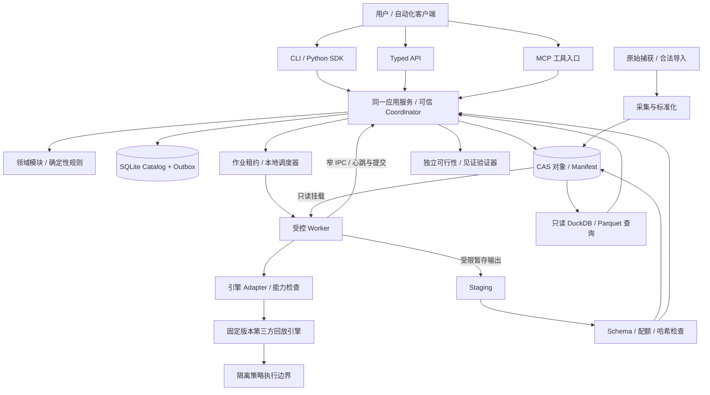
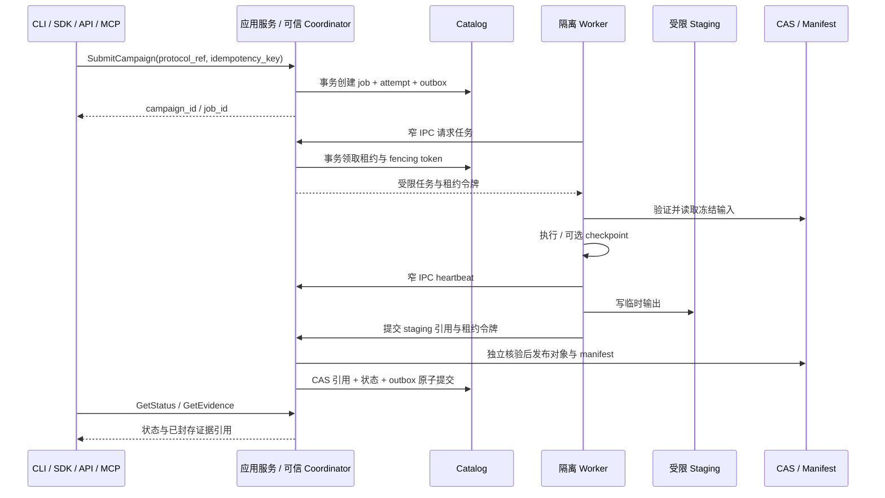

# TickWitness：系统设计

状态：**Proposed / 尚未实现**。TickWitness 是面向可重放证据的研究平台，目标仓库为 `Darrenus/tickwitness`。本文给出分阶段目标架构及其发布约束。接口、目录、表名和状态均为建议契约，未经过实现验证；不构成现有产品能力声明。领域术语以 [domain-model.md](domain-model.md) 为准。

当前实施次序与发布 gate 见 [路线图](../planning/roadmap.md)、[Sprint backlog](../planning/sprint-backlog.md) 和 [质量策略](../quality/quality-strategy.md)。本文描述目标架构及依赖，不要求所有目标能力同时进入 0.1。项目软件采用已选择的 Apache-2.0；依赖和输入数据权利独立核查。

## 1. 架构目标与初期边界

平台首先面向本地研究者：读取已捕获的数据与策略 artifact，冻结研究协议，使用现成引擎执行受约束情景，将反例、覆盖和判定保存为可迁移证据包。初期采用 **Python 模块化单体 + 隔离 worker + 本地内容寻址存储 + SQLite 元数据目录 + Parquet/DuckDB 分析**。

业务边界与部署边界分别设计。多个 bounded context 可以在一个进程中运行；计算任务和不可信代码需要独立执行边界，不意味着每个上下文都要变成服务。首期不引入 Kafka、Kubernetes、分布式事务或强制 Event Sourcing。

首个实施范围应限制为一个交易所、一个交易对、一个版本固定的引擎 adapter、少量基础策略和两种变换：额外延迟压力与L2队列解释。时钟证据先保留来源、区间和未知值；获得可校准证据后再扩展时钟情景变换。多交易所、实时托管、多用户协作和更多成交模型逐项扩展。

## 2. 组件与信任边界



策略执行边界的具体方式取决于引擎能力。若引擎必须把策略代码加载进同一 Python 解释器，则**整个执行 worker 都视为不可信区域**，通过受控宿主验证输出。不能把图中的逻辑分离误当成已经具有安全隔离。

可信 coordinator 是本地 Catalog 的唯一 writer，可与应用服务同进程部署；独立 verifier 由其调度，不信任策略 worker 自报的验证结果。worker 只有只读输入和受配额 staging，通过窄 IPC 交互，不获得数据库写连接或最终发布权。

## 3. 建议代码组织

```text
src/tickwitness/
  contracts/                 # JSON Schema、公开 DTO、兼容版本
  domain/
    research_contracts/
    counterexample_search/
    evidence_verdicts/
    data_evidence/
    replay/
    experiment_registry/
  application/
    services/                # 所有入口调用的 use cases
    process_managers/        # 长流程协调
    ports/                   # Catalog、CAS、Engine、Sandbox 等端口
  infrastructure/
    catalog_sqlite/
    object_store_local/
    query_duckdb/
    engines/                 # 每个引擎的反腐层
    collectors/
    scheduler_local/
    sandbox/
  interfaces/
    cli/
    api/
    sdk/
    mcp/
  workers/
schemas/
tests/
```

领域层使用 Python dataclasses / 枚举与显式不变量；Pydantic 等解析依赖留在接口和契约边界。价格、数量和资金计算采用整数 ticks/lots/minor units 或有固定精度与舍入规则的 `Decimal`。统计计算可使用浮点，结果标注公式、依赖版本、平台和容差。

adapter 必须通过能力协商返回明确支持矩阵，包括 book 类型、订单类型、队列模型、时钟、成交顺序、手续费、资金费、随机源与 checkpoint。缺少能力时在运行前拒绝，不能自动退化后沿用原声明。

## 4. 数据与存储

### 4.1 三类存储分工

| 存储 | 保存什么 | 一致性和访问要求 |
| --- | --- | --- |
| SQLite Catalog | 聚合状态、版本引用、jobs/attempts、幂等键、outbox/inbox、artifact catalog、权限记录 | 初期单机 WAL、事务写入、外键与唯一约束；可信 coordinator 中的应用服务是唯一 writer |
| CAS 对象存储 | 原始捕获片段、Parquet、策略 artifact、协议快照、checkpoint、trace、report、manifest | 对象不可变，使用内容哈希寻址；已封存对象只读 |
| DuckDB 分析层 | 对冻结 manifest 解析出的 Parquet 做范围查询和统计 | 只读数据访问；不是权威作业状态库，也不是访问控制边界 |

初期目录可以采用 `objects/sha256/<prefix>/<digest>`、`staging/<attempt-id>/`、`catalog/catalog.sqlite`。manifest 使用相对逻辑对象引用与哈希，不包含不可移植的宿主绝对路径。

同一 workspace 的 CLI、嵌入式 SDK 和本地 API 必须复用或连接已启动的 coordinator。writer 的独占宿主锁防止多个入口各自启动独立写入者；readonly 查询可分开执行。SQLite 的单事务写互斥不替代应用级作业所有权。

Parquet 通常按 source / instrument / UTC capture date 分区，按采集规模控制 row group 和文件大小；最终划分应由实测选择。不可用“按事件日期分区”推断当时已知。原始接收记录和标准化数据版本分开保存。

### 4.2 最小数据字段

| 字段组 | 示例 | 语义 |
| --- | --- | --- |
| 身份 | `source`、`instrument_id`、`session_id`、`capture_seq`、`raw_object_ref` | 原始来源与捕获顺序 |
| 交易所顺序 | `source_sequence_start/end`、`snapshot_id`、`book_epoch_id` | 适用哪种交易所同步规则；不强行统一成一个虚假序列 |
| 时间 | `exchange_event_time_ns`、`receive_wall_time_ns`、`receive_monotonic_ns`、`clock_segment_id` | 事件时间、接收时钟与时钟映射证据分别保留 |
| 可用性 | `availability_lower_ns`、`availability_upper_ns`、`availability_evidence_kind` | 有证据时记录可用时间区间；无法确定时显式 `UNKNOWN` |
| 质量 | `book_valid`、`quality_flags`、`gap_ref`、`normalization_version` | 缺口和不确定性可查询，不能悄悄修复 |
| 精度 | `price_ticks`、`quantity_lots`、`instrument_spec_ref` | 避免用不明确浮点还原价格与数量 |

历史文件只有 exchange timestamp 时，只能声明“按供应者事件时间回放”；不能升级为历史接收时点认证。跨源排序在无共同可靠时钟时属于区间约束问题，同一流内仍须遵守协议序列和本地单调接收顺序。

clock evidence 要保留测量方法、校准时间、覆盖声明和误差性质。NTP 的经验偏差范围与统计置信区间不是无条件物理上界；超过校准有效期或时钟证据中断时，数据应降级或隔离，而不是继续沿用一个看似精确的纳秒字段。

### 4.3 时点查询

应用服务生成的 `AsOfContext` 至少绑定 `dataset_version`、`capture_watermark`、`decision_time`、`availability_policy`、`clock_evidence_version`。确认性的保守查询只允许 `availability_upper ≤ decision_time` 且证据完整的记录；不确定区间交叠的记录按冻结政策排除或交给观测相容情景解释，不可擅取下界。

派生因子的可用时间按全部依赖和计算完成语义传播。仅写 SQL `event_time <= t` 不足以防前视。历史重建因子的计算耗时是否计入回放，由协议定义；不得把今天批量计算完成时间伪装成过去实际运行过的时间。

用户自定义 SQL 不是权限沙箱。托管场景禁止直接把任意 DuckDB SQL 和 filesystem access 暴露给 Agent；由受控 typed query 解析为已批准的查询计划，限制对象集合、行数、运行时、内存与外部访问。DuckDB 扩展下载、网络读写和不受控 `ATTACH` / `COPY` 必须在执行边界禁止。

### 4.4 缺口与 L2 局限

采集器在检测到协议序列缺口后停止对该段作出有效订单簿声明，进入 resync；新快照产生新的有效 `BookEpoch`。缺失的历史增量不能靠后来的快照恢复。研究协议必须明确拒绝该窗口、暂停策略、还是在单列压力情景中研究缺口影响，并报告受影响时段和持仓。

L2 表示按价格聚合的可见数量，不直接给出每笔撤单在己方之前或之后、hidden orders、全部优先级规则或真实订单到达位置。平台可以比较模型解释，不能声称从 L2 重建真实队列。历史回放也不包含被模拟订单引起的真实市场反应；需限制适用订单规模并报告 market impact 假设，不能把 sweep book 等同于完整反事实影响模型。

## 5. Manifest 与原子发布

每个 `DatasetManifest`、`RunManifest`、`BundleManifest` 包含 schema version、内容对象列表、上游哈希、生成器语义版本、创建主体与校验摘要。策略、协议、数据、模型、种子、instrument spec、容差和环境 lock 都参与 provenance。

本地发布顺序：

1. 写到每次 attempt 独有的 staging 目录，施加输出文件数和总字节上限。
2. 验证 JSON Schema、预期字段、对象大小、内容哈希、Parquet schema 和依赖引用。
3. 写对象临时文件、完成必要的持久化同步后，将对象原子放入 CAS；同内容对象重复写为幂等成功。
4. 所有依赖对象存在后生成 canonical manifest；校验并持久化，再通过同文件系统原子 rename 发布。
5. SQLite 事务插入 manifest 引用、更新聚合状态并写 outbox。只将已发布且核验的 manifest 标为可消费。

文件系统与数据库不存在一个跨两者的 ACID 事务。崩溃可能产生“CAS 已有对象、Catalog 尚未引用”的孤立对象；启动 reconciler 校验并恢复或延后回收。不能先把 Catalog 标为 completed，再期待后台补文件。

对象存储 adapter 使用条件写和完整哈希验证来实现同等发布语义，不假设 S3 rename。manifest 是提交边界；列表可见或文件存在不等于证据已提交。

CAS 去重不自动提供访问控制。将来多租户须按 workspace scope 授权每个引用，防止通过猜哈希读取对象；签名和存储服务器信誉也不能证明输入历史本身真实。

## 6. 作业、幂等与崩溃恢复

### 6.1 执行流程



同一个幂等键按 `workspace + operation + key` 唯一。重复请求且 request digest 一致返回同一结果；键相同但 payload 不同返回冲突。幂等键不是数据内容哈希：用户可以显式要求同一配置进行独立复验，此时使用新操作键并保留相同 config digest。

### 6.2 租约和重试

- 每个 job 有逻辑 ID，每次执行有独立 attempt ID。重试创建新 attempt，不覆盖失败记录。
- coordinator 通过短事务领取租约并授予 worker 递增 fencing token；心跳、预算扣减和最终提交都由 coordinator 校验令牌后写库。过期 worker 的提交不能改变当前 job 的权威状态。
- 网络中断或崩溃后，调度器检测租约失效。状态为 `ABANDONED` 的 attempt 保留其已封存 checkpoint；后续按恢复政策重新执行。
- 输入错误、模型不支持、约束不可行等确定性错误不自动重试；临时存储错误可有限重试；反例本身不是失败。
- outbox/inbox 使用唯一 event ID 去重，提供至少一次投递。不能将 job 只执行一次当作可靠性前提。
- 相同 seed 的重试沿用原语义；若主动更换 seed，登记为不同情景执行，不能混成同一个可重复结果。

### 6.3 取消与预算

取消命令先持久化 `CANCEL_REQUESTED`，worker 在确定的事件批次或检查点检查令牌、停止新增子任务并保存退出记录。超过宽限期可以终止执行边界。取消只终止后续计算，不删除历史 attempt。

终止中的临时输出不会自动封存为完整运行；已独立验证的早期 witness 可单独封存，附取消与部分覆盖事实。`execution_status` 中的取消、超时或预算耗尽不能被直接映射成 `NO_COUNTEREXAMPLE_FOUND`。已完成子范围的发现须保留其独立 scope，并在 `completeness` 中列出未完成范围；没有有效覆盖时只能记录证据不足及停止原因。

预算包括 scenario 数、引擎调用数、CPU 时间、墙钟、内存、输出字节和最简化验证次数。预算消耗由宿主记录；不能相信策略自报。任务等待时间与计算时间分开，避免无意改变统计预算。

### 6.4 Checkpoint

checkpoint 至少包括数据 cursor 和 epoch、初始/当前订单簿、策略状态、未完成订单、资金账本、随机源状态、待送达消息队列。身份还须绑定 frozen protocol、策略 artifact、引擎/adapter 语义、seed vector、数据 manifest digest，以及 cursor 之前的情景变换语义 digest。

先验证恢复前后在固定 trace 上一致，才启用 resumable 能力。第三方引擎若不能导出完整状态，标记 `checkpoint_supported=false`，崩溃后从冻结输入重新执行；不能用不完整 pickle 伪装恢复。对外证据包禁止加载不可信 pickle。

将长前缀折叠成 checkpoint 用于 witness 缩减时，必须按该情景从原始输入重新生成并核验。新增延迟、时钟或队列解释只要影响 cursor 之前的行为，就必须重新生成，不能复用基线策略状态。只有证明并记录前缀输入、决策及状态语义等价，才允许跨情景复用；数据相同、时间相同或 cursor 相同都不足够。修改 checkpoint 直接制造损益不属于合法最简化。

合法缩减不依赖引擎支持 checkpoint：每个候选可以从有效原始起点重放完整必要前缀，再评价缩减后缀；该前缀仍属于可重放见证依赖，不能通过裁剪隐藏 warm-up、订单或持仓。checkpoint 作为可选性能优化和中途恢复能力分别验收，不能把“无完整状态导出”变成伪恢复。具体阶段以 backlog 的缩减和作业恢复故事为准。

## 7. 搜索与判定执行路径

搜索器只提出 typed scenario。执行顺序为：

```text
冻结协议
  → 数据/引擎能力预检
  → 生成情景（观测相容 / 反事实压力分别管理）
  → 独立可行性校验
  → 固定输入回放
  → 原始结果与轨迹核验
  → 确定性命题评价
  → 反例独立重跑
  → 约束保持的见证缩减
  → 覆盖汇总、封存证据、出具判定
```

初期搜索使用可解释网格、枚举和有界启发式，避免把复杂 RL 搜索作为前置条件。paired comparisons 使用明确的共同随机源政策，降低被随机 seed 混淆的差异；结果同时报告跨 seed 的变动。

最简化必须始终重验可行性、执行成功与命题失败。保存其变换集合、次数、预算和终止理由，输出 `NOT_MINIMIZED`、`LOCALLY_MINIMAL`、`BEST_FOUND` 或 `EXHAUSTIVE_FINITE` 的精确主张。后两者分别描述最佳发现与有限集合穷举，不能互换。

判定器独立于 Agent 和搜索器，统一输出 `execution_status + findings[] + completeness`。校验无效、能力不支持、执行错误、取消和超时属于校验/执行结果；`findings[]` 每项包含 `type`、`scope`、证据与限制。`INSUFFICIENT_EVIDENCE` 单列证据不足 finding，不能代替具体执行错误；空的有效覆盖不生成“未找到反例”。

`NO_COUNTEREXAMPLE_FOUND` 只描述明示 scope 中已成功验证的情景，并列出完整覆盖信息。同一 scope 不能同时有 `COUNTEREXAMPLE_FOUND` 和 `NO_COUNTEREXAMPLE_FOUND`，含已验证反例的范围不能宣称未发现。`NOT_IDENTIFIABLE_WITHIN_MODEL` 必须引用两个观测相容、命题结果相反的有效见证，可以与引用失败见证的 `COUNTEREXAMPLE_FOUND` 同时存在。不同子范围的发现分开展示；收益 min/max 是已执行情景的 envelope，不是实际收益上下界或置信区间。

## 8. API、SDK 与 MCP

所有入口调用相同应用服务和授权端口。MCP 不是特权后门，也不应内嵌另一套判定逻辑。Python SDK 可以在本地嵌入应用服务；HTTP 客户端和 MCP 只是不同 transport。

建议 use cases：

| 应用服务 | 输入 | 输出 |
| --- | --- | --- |
| `register_claim` | typed claim、基线、scope | claim revision ref |
| `freeze_protocol` | 数据/策略/假设/规则/预算版本 | frozen protocol ref + digest |
| `submit_campaign` | protocol ref、scenario set ref、幂等键 | campaign/job ref |
| `get_campaign_status` | campaign ref | 阶段、覆盖、资源与失败摘要 |
| `cancel_campaign` | campaign ref、版本条件 | 已持久化的取消请求 |
| `query_asof` | dataset ref、AsOfContext、typed query | 有界结果 + provenance |
| `replay_witness` | witness ref、执行预算 | replay receipt |
| `get_evidence` | bundle ref | 授权后的 manifest 与报告 |
| `verify_bundle` | bundle ref | schema/hash/依赖与判定一致性报告 |

公开请求/响应采用版本化 JSON Schema；不允许 NaN/Infinity，64 位以上精确整数在跨 JavaScript 边界时用单位明确的十进制字符串。时间使用 epoch ns 的字符串并明确 clock domain；人类展示层再格式化时区。

长任务返回 job ID；HTTP 可采用 `202 Accepted`，SDK 返回 handle，MCP 返回同一 job ref 并通过查询工具获取状态。分页、大小上限、deadline、错误代码、request ID、schema version 均属于契约。

MCP 权限分级可以是 `read_evidence`、`query_registered_data`、`submit_bounded_run`、`manage_protocol`。Agent 不拥有修改已冻结对象、解封任意 holdout、执行任意 shell、调用宿主文件系统或把 draft report 提升为 final verdict 的能力。正式权限隔离尚未实现前，README 应明确只适合可信本地研究。

确认数据控制分两层逐步实现：冻结协议的最小应用路径即检查研究阶段与样本范围，拒绝探索接口读取确认数据；后续 exposure ledger 记录何人、何时、通过哪个协议接触过哪些结果。派生协议、新 trial 或重新开窗必须继承已接触记录，不能恢复未见状态。该策略约束应用入口；本地宿主 owner 能直接读取其文件，产品不承诺对 owner 保密或阻止其离线篡改。

## 9. 不可信代码与发布门槛

**独立 Python 进程只隔离崩溃，不提供恶意代码安全边界。** 用户策略、依赖和自定义变换可能读取文件、联网、fork、消耗内存、写超量输出或伪造结果。普通 Docker 配置也不能仅凭“用了容器”就宣称安全。

本地首期可仅运行用户自己审阅的可信策略，明确风险模型；即使如此仍应启用资源限制、只读输入、独立工作目录和无凭据环境。托管运行第三方代码前必须有独立 release gate：

| 控制 | 最低可验证要求 |
| --- | --- |
| 执行隔离 | 经评估的容器/微虚拟机或等效边界；非 root、无宿主敏感挂载、无 Docker socket、capabilities 最小化 |
| 网络 | 默认无网络；依赖预先构建和固定；不能访问云 metadata、内网和控制平面 |
| 文件系统 | 输入只读、输出独立且受配额、禁止逃逸 symlink 和任意宿主路径 |
| 资源 | CPU、memory、PID、文件描述符、墙钟、磁盘与输出字节硬限制；宿主可强制终止 |
| 凭据 | worker 不持有用户 API key、服务数据库写凭据或对象存储全权限 token |
| 通信 | schema 化窄 IPC；禁止宿主反序列化不可信 pickle；限定日志和结果大小 |
| 输出核验 | 宿主不信任 worker 状态和哈希声明，独立检查对象与关键账本不变量 |
| 验证 | 专项测试文件读取、网络、子进程、fork bomb、内存/磁盘耗尽、输出污染和超时逃逸 |

release gate 未通过就不能提供“任意仓库上传即运行”的公开托管服务。多租户身份、配额、对象授权和租户隔离同样是托管 gate，不属于可推迟的 UI 功能。

## 10. 确定性与版本策略

单一 package version 不能完整描述研究语义。每次运行至少记录：

- `contract_schema_version`：输入/输出结构。
- `data_normalization_version` 与源协议版本：数据含义及缺口处理。
- `clock_policy_version`：可用时间、误差和跨源排序规则。
- `engine_version`、adapter commit、`execution_semantics_version`：事件先后、撮合、费用、队列与舍入。
- `metric_formula_version`、`rubric_version`：统计公式与判定规则。
- `scenario_transform_version`、`search_algorithm_version`、`minimizer_version`：情景与覆盖含义。
- Python/依赖 lock、系统架构、线程策略、随机数算法与每个随机源 seed。

任何会改变结果含义的修复必须增加相应语义版本；旧证据继续绑定旧版。采用 SemVer 管理公开契约，但 bugfix 只要影响撮合或评价，就必须留下语义变化记录，不可因为是 patch 就隐藏。

确定性级别显式区分 `BITWISE`、`NUMERIC_TOLERANCE`、`STATISTICAL`。本地重跑可优先追求逐位一致；跨 OS/CPU/底层库只在声明容差内承诺。固定 seed 不能保证线程调度、外部服务或不同算法版本相同。

## 11. 可观察性与恢复操作

所有日志附 `workspace_id`、`campaign_id`、`job_id`、`attempt_id`、`correlation_id`、协议/数据 digest。运维指标包括排队时间、运行耗时、有效/拒绝/失败情景数、checkpoint 恢复成功率、哈希错误、孤立对象、取消延迟和预算超限。

研究正确性指标与服务可用性指标分别展示。API 200 或 worker exit 0 不能代替证据完整。采集 gap rate 的分母、重复判定口径和 clock uncertainty 覆盖率必须版本化；数据质量告警不能自动修复并重写历史。

备份至少覆盖 SQLite 一致性快照和被引用 CAS 对象。恢复演练验证 catalog/manifest 引用闭合、哈希和封存判定；仅复制一个仍在写入的 SQLite 文件不构成可靠备份。

GC 采用 manifest 引用图与宽限期，保护进行中的 staging、租约和导出任务。首期可手动清理已明确孤立的对象；自动 GC 实施前必须通过崩溃与并发测试，不能用文件 mtime 推断无用。

## 12. 验证设计

| 层次 | 必须证明的事情 |
| --- | --- |
| 领域不变量测试 | 冻结对象不可改、取消/失败不算通过、情景类型不混淆、最终判定引用封存证据 |
| 引擎契约测试 | 同一小型金标准事件流的订单、成交、费用、队列/延迟和时序符合 adapter 声明 |
| 数据状态机测试 | snapshot/delta、重复、缺口、重连、时间回拨、跨日片段不破坏有效 epoch |
| 反例测试 | 人工植入的已知缺陷能产生有效 witness；干净对照不会被可行性验证器误判 |
| 最简化测试 | 缩减保留有效初始状态与序列；重放仍触发同一证伪条件；最简性主张符合实际算法 |
| 幂等与故障测试 | 在对象发布、manifest、Catalog commit、租约更新等边界崩溃后能安全重试 |
| 恢复一致性测试 | checkpoint resume 与完整重放在声明确定性级别一致；不支持的引擎拒绝恢复 |
| 安全测试 | 本地可信模式边界清晰；托管模式通过第 9 节的逃逸和资源控制验证 |
| 产品端到端测试 | 从干净环境可离线验证证据包并重放至少一个最小反例，不依赖 Agent 的记忆 |

性能 benchmark 分开测采集、标准化、范围查询、单次回放、搜索和 witness 验证，报告硬件、数据规模、真实/合成输入、冷热缓存、重跑命令和误差。首期没有实测数据前，不把吞吐、P99 或压缩比写成已达成指标。

## 13. 从本地到多人服务的演进门槛

| 阶段 | 架构 | 迁移触发条件与退出要求 |
| --- | --- | --- |
| A：本地可信研究 | 模块化单体、SQLite、本地 CAS、单机 workers | 两个可重放 witness、明确 coverage、原子发布和崩溃恢复验证通过 |
| B：团队共享 | 同一领域模块、Postgres Catalog、对象存储、独立调度 | 出现多主机写入需求、SQLite 锁等待持续超过约定 SLO，或权限/运维需要集中服务；完成数据迁移、幂等、租约和备份恢复验证 |
| C：托管不可信执行 | 独立控制平面与沙箱 workers、租户配额/授权 | 第 9 节 gate、多租户隔离、依赖构建和运营响应验证通过后才开放 |
| D：有证据的拆分 | 按实际瓶颈拆独立数据或执行服务 | 存在独立扩缩容/故障隔离/团队所有权需求；先保持 published contracts，再拆部署 |

不以数据行数本身作为迁移数据库理由；SQLite 的问题主要来自写入并发、跨主机协调和运维要求。Parquet 分析规模增大可以先优化布局和 DuckDB 扫描，不必同时更换 Catalog。

每次阶段升级均保留旧证据读取与验证路径。引擎升级和存储迁移不能要求用户重新相信无法重放的报告。

## 14. 实施顺序

1. 按当前 planning baseline，S1 timebox 比较候选引擎的安装、许可、轨迹和能力，用微型 fixture 做可行性 spike；不同时承诺完成两个 production adapter。
2. S2 记录默认引擎选择，冻结首批契约；实现最小 Catalog/CAS、不可变 manifest、原子导入与应用层 holdout deny。此阶段的候选引擎探索值不作为正式产品性能基线。
3. S3 完成默认 adapter 与能力契约后建立同语义性能基线，再打通可信 CLI 的导入、冻结、回放、导出和离线验证。完整持久化 jobs 与中途恢复不是这一最小同步路径的前置条件。
4. 完善受约束情景、覆盖记录和见证缩减。没有 checkpoint 时允许从有效前缀重新回放；checkpoint 优化仅在等价性验证通过后启用。
5. 在后续作业阶段实现持久化状态、幂等重试、恢复/取消及资源限制，再稳定 typed SDK/API 和相同应用服务的 MCP 入口。具体发布 gate 和阶段依赖遵循最新路线图，不因本节概述而提前声称完成。
6. 根据实测的使用需求、质量证据和安全发布 gate 扩展团队能力、隔离执行与市场覆盖。

实施中用 ADR 记录语义取舍，每个 proposed 能力以可运行验收证据升级为 implemented。架构图不是完成标准，可重放与范围诚实的证据才是。
