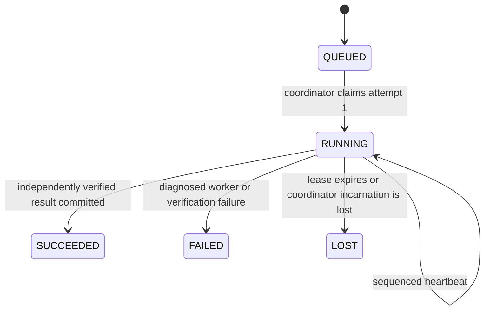

# Job lifecycle v1

S10-01, accepted by owner merge of [PR #101](https://github.com/Darrenus/tickwitness/pull/101), 2026-11-06 (Asia/Singapore). [ADR 0032](../adr/0032-durable-local-comparison-jobs.md), [Sprint 10 status](../planning/sprint-10-status.md), [story #28](https://github.com/Darrenus/tickwitness/issues/28). Actual qualification is recorded on the implementation PR and its CI artifacts. External human reproduction remains **0 / PENDING**.

## Supported operation and identity

The first managed operation, `compare_reduction_run_v1`, calls [Reduction Comparison v1](reduction-comparison-v1.md). Its worker reaudits an already committed reduction and the original false scenario. Its coordinator independently reconstructs the saved export before accepting the Job result. Existing source, ledger, findings and research budgets are read-only. The operation does not run a native engine, reserve an attempt or publish a new research manifest.

`comparison_job_spec_v1` has exact fields `kind`, `schema_version=1`, `operation`, `request` and `lease_duration_ns`. Request fields are exactly `run_id`, `expected_bundle_id`, `expected_report_id`, `input_root`, `source_evidence`, `runs` and `split="development"`. The three IDs are lowercase SHA-256 pins, rechecked on actual reads. Paths are trusted owner locators, not evidence authority. Input/ledger trees and the Catalog must be disjoint. Source evidence is a relative path without traversal. Descriptor bytes are bounded at 64 KiB; leases are integer nanoseconds from 1 to 60 seconds, default 30 seconds.

The Job ID is the SHA-256 of the strict canonical descriptor. Resubmitting exactly those bytes returns the existing Job, including its existing terminal state. Relocating locators changes that descriptor; this does not grant research budget. A Job has one separate `job_attempt_id` bound to its Job ID, attempt number 1 and fresh nonce. This identity is never a `replay_attempt_reservation_v1`, and does not imply an attempt from any research protocol. No reset, automatic retry or second Job attempt is supported in this version.

## State and time



Each accepted mutation increments the aggregate version and appends an event. Wrong versions, attempts, coordinator incarnations, lease tokens, out-of-order heartbeats, expired submissions and all terminal rewrites are rejected. A heartbeat sequence increases by exactly one. A terminal IPC frame is also the final heartbeat; it does not itself publish success.

Persisted snapshots have `job_id`, complete spec, `state`, `version`, UTC nanosecond `created_at_ns` / `updated_at_ns`, attempt, result hash and failure. The attempt records number, nonce, coordinator incarnation, lease token, heartbeat sequence/time and expiry. Public views redact nonce and token. Failure is `{code,message,worker_exit_code}`; actual negative signal exit codes are retained. FAILED or LOST describes execution, not a false research claim or absence of a counterexample.

The coordinator timestamps received heartbeats. Its in-process monotonic deadline bounds waiting for lease delivery, including pipe IO. Persisted monotonic values are never reused across boots or processes. Backwards UTC timestamps are refused for mutation and exposed as uncertainty. Time discipline of the trusted host remains an operational requirement.

Read-only inspection presents `stored_state` separately from effective `state`. RUNNING with no active coordinator lock is `COORDINATOR_LOST`; an expired lease is `LEASE_EXPIRED`; backwards UTC is `CLOCK_UNCERTAIN`. These are diagnostics, not silent state writes. Explicit new ownership reconciles old-incarnation RUNNING Jobs to durable LOST. PID reuse cannot renew a lease. Reconciliation never restarts a worker, restores a checkpoint, refunds a research attempt or repairs missing research output.

## Catalog, IPC and publication

Only a trusted coordinator holding the Catalog's exclusive nonblocking POSIX lock can mutate it. SQLite transactions use optimistic version checks and contain snapshot, result BLOB and event updates together. No transaction spans process execution or evidence verification. Schema version 1 rejects unsupported versions and malformed data. Read-only queries do not create a Catalog or perform recovery. Explicit writer ownership may let SQLite recover its own rollback journal; uncertain commit or required recovery remains visible. This is not a tamper-proof ledger or a physical power-loss guarantee.

SQLite lock acquisition waits at most five seconds. A BUSY/LOCKED response from a read-only connection is a visible, retryable conflict (exit 9); other read errors remain integrity/IO failures. Write and commit errors remain unconfirmed IO failures and are never automatically retried. Observer gates may retry only the read conflict within their own finite waiting interval; this cannot restart a Job or reserve research budget.

Workers run in a fresh process group and temporary working directory with `-I -B`, and no inherited Catalog descriptor or request field. Only the built-in operation is allowlisted; there is no arbitrary command flag. The private transport override exists solely for trusted test harnesses. Same-UID workers are trusted code, without a hostile-code sandbox claim.

One active coordinator owns at most one worker and one RUNNING Catalog row. This is not an instantaneous global OS-process limit across coordinator death: an orphan may briefly overlap new ownership. The built-in read-only worker exits when it observes a broken heartbeat channel. Scheduled detection and complete orphan process/directory reclamation are separate from S10-01 and remain part of S10-03.

If process-group signaling returns a permission error while the child is exiting, a bounded 0.5-second wait may confirm its actual exit. Without that confirmation, the original permission error remains visible. The wait never renews the Job lease or certifies complete group cleanup. The worker uses the coordinator's current interpreter; optional engine packages being installed does not authorize native construction or execution.

The canonical JSONL request `job_worker_request_v1` carries schema, Job ID, spec, coordinator incarnation, Job attempt and lease token. Frames `job_heartbeat_v1`, `job_result_v1` and `job_failure_v1` carry exact bindings and the next sequence. Result frames add the existing comparison export object; failure frames add the diagnostic. Request size is at most 64 KiB; frame size is at most the existing comparison-export bound plus 64 KiB, with stderr bounded at 64 KiB. Partial, noncanonical, unknown, oversized, repeated-terminal or mismatched frames fail visibly. Pipes are drained incrementally, and owned child processes are reaped on return or interruption.

A success requires a result frame, actual exit 0, an independently reverified export from the pinned source/live records, current-lease authorization at completion admission, and confirmed atomic Catalog publication. The original monotonic deadline is retained throughout verification and both its success and failure paths; UTC cannot create a new waiting window. Lease admission uses the coordinator's recorded command time. Disk commit latency is not a hard realtime deadline, and a slow commit is not undone after acknowledgment. Rehashed semantic forgeries cannot become successful Jobs. The stored result is the existing canonical comparison export with no trailing newline. P, NP and NE domain observations can all yield Job SUCCEEDED; NE retains null domain truth/value.

Publication exceptions propagate. The supervisor does not overwrite a potentially committed SUCCEEDED row with FAILED or manufacture an acknowledged result. A coordinator interrupted before confirmation leaves persisted facts for independent inspection and explicit reconciliation. S10-02 owns retry and final research-manifest publication; S10-03 owns strong cancellation, total deadlines, resource ceilings and orphan temporary-directory policy.

## CLI

```sh
tickwitness submit-comparison-job RUN_ID \
  --input-root /owner/inputs --source-evidence portable/source \
  --runs /owner/runs --expected-bundle-id BUNDLE_ID \
  --expected-report-id REPORT_ID --jobs /owner/jobs
tickwitness inspect-job JOB_ID --jobs /owner/jobs --events
tickwitness run-job JOB_ID --jobs /owner/jobs
tickwitness read-job-result JOB_ID --jobs /owner/jobs
tickwitness reconcile-jobs --jobs /owner/jobs
```

Only submit creates a Catalog. Confirmation is rejected before identifiers, paths or Catalog access. Inspect and result reads never reconcile or start execution. Run owns the coordinator until its one worker completes; repeated terminal runs return the same state without another worker. Reconcile is explicit and never resumes.

Valid state operations, including a returned FAILED or LOST view, exit 0. Automation must inspect the returned state; exit 0 alone is not Job or research success. Validation exits 2, Catalog/integrity/uncertain IO 3, missing Job/Catalog 4, confirmation 5 and ownership/version/terminal/read-busy conflicts 9. Reading a non-succeeded Job result is conflict 9. `--events` exposes at most the latest 100 event metadata records, without tokens or a full-history claim.

## Remote qualification

The existing remote CPU checks exercise pure contracts, SQLite mutation/rollback/concurrency and real bounded IPC. Installed core, Ubuntu, macOS and actual-source/wheel profiles save transcripts, Catalogs, results, events and file manifests under `jobs-*` artifacts with 30-day retention. Positive profiles reuse their already executed eleven-slot S09 lifecycle; best and NE Jobs consume no additional research attempts or native runs. Core-only profiles record their actual refusal scope rather than fabricate a reduced native execution.

Real worker and coordinator death, heartbeat expiry, orphan reconciliation, stale credentials, malformed output, independent forged-result refusal and publication failure require their own observed records. CI and AI review remain automation. Owner acceptance, external human reproduction and a release are separate gates; no new release is issued by this contract.
